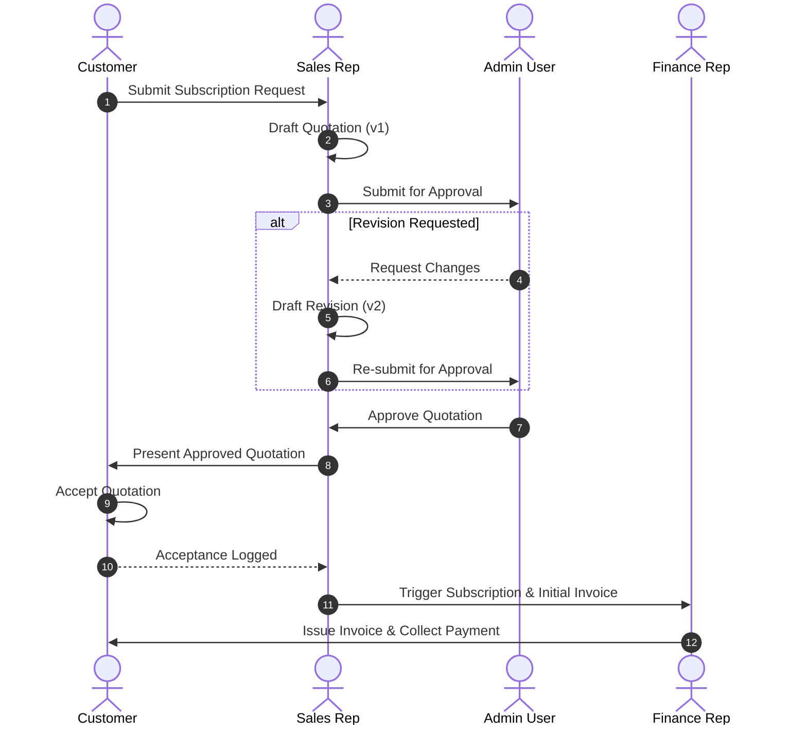

# System Architecture: Brightloop Subscription Management System (SMS)

## 1. High-Level Overview

Brightloop Subscription Management System is a centralized B2B SaaS platform engineered to manage the end-to-end commercial subscription lifecycle: from initial customer request to quotation creation, mandatory Admin approval, customer acceptance, recurring invoice generation, and multi-mode payment reconciliation.

```mermaid
flowchart TD
    subgraph ClientLayer [Client Applications]
        CP[Customer Portal\n(Self-Service, Subscriptions, Invoices)]
        IP[Internal Portal\n(Admin, Sales, Finance Dashboards)]
    end

    subgraph APILayer [FastAPI Application Service]
        Auth[Auth & RBAC Middleware]
        Commercial[Commercial Engine\n(Requests, Quotes, Approvals)]
        SubEngine[Subscription Engine\n(Lifecycle & Seat Tracking)]
        BillingEngine[Billing & Recurring Invoicing Engine]
        ReconEngine[Payment & Reconciliation Engine]
        Audit[Immutable Audit Logging]
    end

    subgraph StorageLayer [Data & Cache]
        DB[(PostgreSQL / SQLite Storage)]
        Redis[(Redis Task Queue)]
    end

    CP -->|HTTPS / JWT| Auth
    IP -->|HTTPS / JWT| Auth
    Auth --> Commercial
    Auth --> SubEngine
    Auth --> BillingEngine
    Auth --> ReconEngine
    Commercial --> Audit
    SubEngine --> Audit
    BillingEngine --> Audit
    ReconEngine --> Audit
    Commercial --> DB
    SubEngine --> DB
    BillingEngine --> DB
    ReconEngine --> DB
```

---

## 2. Core Architectural Pillars

### 2.1 Multi-Tenant Isolation & Customer Scoping
- **Strict Business Scoping**: Every customer user is scoped to their specific `customer_business_id`.
- **Database-Level Isolation**: API queries enforce filtering by `customer_business_id` server-side before retrieving or returning any commercial/financial records.
- **Cross-Tenant Access Prevention**: Tested rigorously to ensure users from Business A cannot view or manipulate records from Business B.

### 2.2 Controlled Commercial Workflow
The commercial lifecycle guarantees traceability and enforces segregation of duties:
1. **Request**: Customer submits a subscription request (product variant, plan, requested seats, start date).
2. **Quotation Generation**: Sales representatives build quotations with itemized products, plan terms, discounts, and tax computations.
3. **Mandatory Admin Approval**: Quotations cannot be sent to customers without explicit Admin authorization. Any modification creates a new immutable quotation version requiring re-approval.
4. **Customer Acceptance**: Customer accepts the quotation, creating an immutable audit record (user, timestamp, exact accepted version).
5. **Subscription Activation & Invoicing**: Automatic provisioning of active subscriptions and immediate trigger for first invoice generation in Finance.



### 2.3 Idempotent Billing Engine
- **Duplicate Prevention**: Invoices use deterministic period keys (`subscription_id + billing_period_start + billing_period_end`) ensuring background recurring runs never duplicate invoices.
- **Independent Status Families**:
  - `SubscriptionStatus`: DRAFT, ACTIVE, PAUSED, CANCELLED, EXPIRED.
  - `InvoiceStatus`: DRAFT, ISSUED, PARTIALLY_PAID, PAID, VOID.
  - `PaymentStatus`: PENDING, COMPLETED, FAILED, REFUNDED.
  - `ReconciliationStatus`: UNMATCHED, MATCHED, DISCREPANCY, MANUAL_REVIEW.

---

## 3. Technology Stack Breakdown

| Component | Technology | Rationale |
|---|---|---|
| Frontend Framework | React 18 + TypeScript | Type safety, modularity, dynamic UI updates |
| Build Tool | Vite | Fast HMR, optimized production bundles |
| Styling | Tailwind CSS | Consistent utility-first design system |
| Backend Framework | FastAPI (Python 3.11+) | Async performance, auto-generated OpenAPI docs |
| Data Layer | SQLAlchemy 2.0 ORM + Alembic | Modern query syntax, version-controlled schema migrations |
| Database | PostgreSQL / SQLite | ACID compliance, transactional integrity |
| Security | OAuth2 / JWT + Passlib (Bcrypt) | Secure bearer token auth, salted password hashing |
| PDF Engine | ReportLab | Programmatic vector PDF invoices and quotes |
